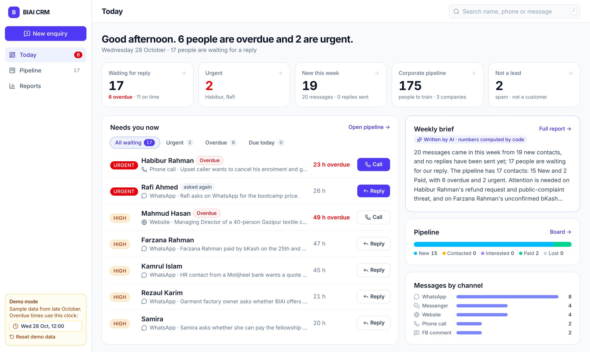
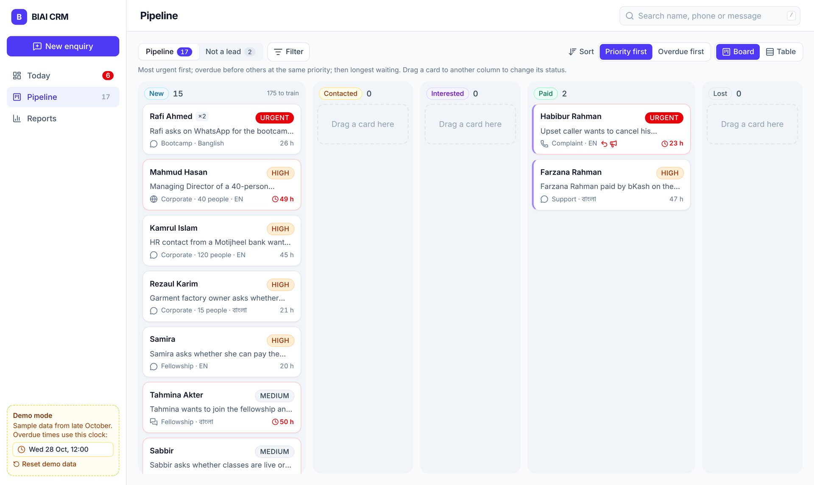
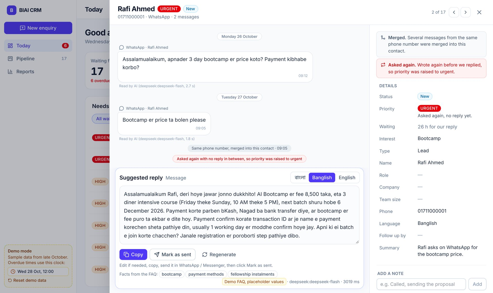

# BIAI CRM

A small CRM for BIAI's admissions team. Paste any enquiry from WhatsApp, Facebook, the website or a phone call,
in Bangla, Banglish or English. The AI fills in the record and suggests a reply in the sender's language, using
only facts from BIAI's FAQ. A Today screen shows who to answer first.

**Live demo:** https://biai-crm.fastapicloud.dev (sample data only; nothing to sign in to)



## Using the demo

- It opens on **Today**: who is overdue or urgent, and a queue of everyone waiting for a reply.
- The sample enquiries are from 26–27 October 2026, so a **demo clock** (bottom left, set to Wed 28 Oct, 12:00)
  drives every "overdue" and "48 hours" check. Change it to see the follow-ups move.
- **Reset demo data** (bottom left) reloads the 20 sample enquiries and undoes every change.
- The FAQ prices and policies are **placeholders**, labelled as such next to every reply.
- Shortcuts: `/` search, `n` new enquiry, `j` / `k` next / previous contact, `Esc` close.

## What it does

| | |
|---|---|
| **Reads a pasted message** | Name, role, company, team size (Bangla digits too), phone, what they want (bootcamp, fellowship, corporate), language, message type (lead, support, complaint, spam, not a customer), priority with a reason, deadlines such as "tomorrow after 5 PM". Fields the AI is unsure about are marked for a human to check. |
| **Suggests a reply** | In Bangla script, Banglish or English, matching the sender, with a one-click switch. Facebook comments get a short public reply, call notes get a call script, spam gets none. Facts come only from the FAQ; anything else becomes "the team will confirm". |
| **Catches lost enquiries** | Messages from the same phone number merge into one contact. Someone who writes again before we replied becomes urgent. Overdue after 48 hours, or when their own deadline passes. |
| **Pipeline** | New, Contacted, Interested, Paid, Lost as a board (drag to move) or a table, with filters, search and two sort orders. Spam and job seekers stay in a separate "Not a lead" tab. |
| **Weekly summary** | Code computes every number; the AI writes the overview and a "chase first" list. Every number in the text is checked against the data. CSV export. |

<table>
  <tr>
    <td></td>
    <td></td>
  </tr>
  <tr>
    <td>Pipeline: the whole board on one screen</td>
    <td>Contact: Rafi asked twice, so the two messages were merged and he became urgent</td>
  </tr>
</table>

## How the AI is used

The AI judges one message at a time. Anything that needs other records, arithmetic or the clock is plain,
tested code.

| AI (DeepSeek, Gemini as fallback) | Code |
|---|---|
| Message type, interest, language, priority and reason, deadlines, flags | Phone normalisation (Bangla digits, +880), duplicate merge |
| Reply wording in the target language | Reply format, language, what to ask for; the FAQ is the only source of facts |
| Weekly overview and "chase first" picks | Every number in the summary; overdue and the 48 h rule; escalation to urgent |
| | Checks on every AI output: JSON schema, invented numbers, wrong script, length |

The demo never needs a live AI call: the AI results for the 20 samples, their replies (in all three languages)
and the weekly summary are pre-generated in `backend/seed/`. Only pasting a new message, switching to a reply
language that has no draft yet, and regenerating call the AI live. If the AI is unavailable, the page says so
and a pasted message can be filled in by hand.

## Measured, not assumed

Hand-labelled expected output for all 20 samples is in [`eval/gold.json`](eval/gold.json). Latest run
([`eval/report.md`](eval/report.md)): 20/20 on message type, language, status, interest and name; follow-up dates
3/3; flags 9/9; priority 20/20 within one level (19/20 exact). All 55 pre-written replies pass the reply checks
([`eval/replies.md`](eval/replies.md)). The prompts were improved from the eval's mismatches using general rules,
never by putting the samples in a prompt (a test checks this). Twenty messages is a small set, so real-world
accuracy will be lower.

## Run it locally

Needs [uv](https://docs.astral.sh/uv/) and Python 3.12+. Node 22 is only needed to change the frontend.

```bash
cp .env.example .env    # add DEEPSEEK_API_KEY and GEMINI_API_KEY (only needed for live AI calls)
uv sync
uv run fastapi dev      # http://localhost:8000, seeds the database on first start
```

Frontend development (hot reload; proxies `/api` to the backend on port 8000):

```bash
cd frontend && npm install && npm run dev    # http://localhost:5173
npm run build                                # writes the production build to backend/static
```

## Checks

```bash
uv run ruff check backend tests eval && uv run pytest -q   # 108 backend tests, no network needed
uv run python eval/run_eval.py --report-only               # live extraction eval -> eval/report.md
uv run python eval/run_reply_checks.py                     # checks the saved reply drafts
uv run python eval/run_summary_check.py                    # checks the saved weekly summary
BASE=http://localhost:8000 node tests/e2e/demo.js          # browser run of the demo flow (needs Playwright)
```

## Project structure

```
backend/
  main.py          FastAPI app; serves the API under /api and the built frontend
  api/             contacts, intake (analyse / save), replies, follow-ups, weekly summary + CSV, demo controls
  ai/              client (DeepSeek -> Gemini fallback), prompts, schemas, replies (format + number guard)
  normalize.py     phone normalisation, duplicate merge, escalation, overdue rules
  summary.py       weekly figures computed by code
  db.py            SQLModel tables (SQLite)
  seed/            the 20 sample enquiries, pre-generated AI results, replies and summary, demo FAQ
  static/          built frontend
frontend/src/      React + TypeScript + Tailwind (Today, Pipeline, contact panel, New enquiry, Reports)
eval/              gold labels, extraction eval, reply checks, summary check, reports
tests/             pytest suite and the browser demo script
docs/              build log and screenshots
```

Stack: FastAPI, SQLModel and SQLite; React, Vite and Tailwind; DeepSeek and Gemini through the OpenAI-compatible
API; deployed on FastAPI Cloud (`uv run fastapi deploy`).

## More

- [`NOTE.md`](NOTE.md): the half-page submission note.
- [`PRD.md`](PRD.md): the plan, scoring map, milestones and acceptance checks.
- [`docs/BUILD_LOG.md`](docs/BUILD_LOG.md): decisions and findings recorded during the build.
- [`CLAUDE.md`](CLAUDE.md): standing instructions for Claude Code, which built this project.
